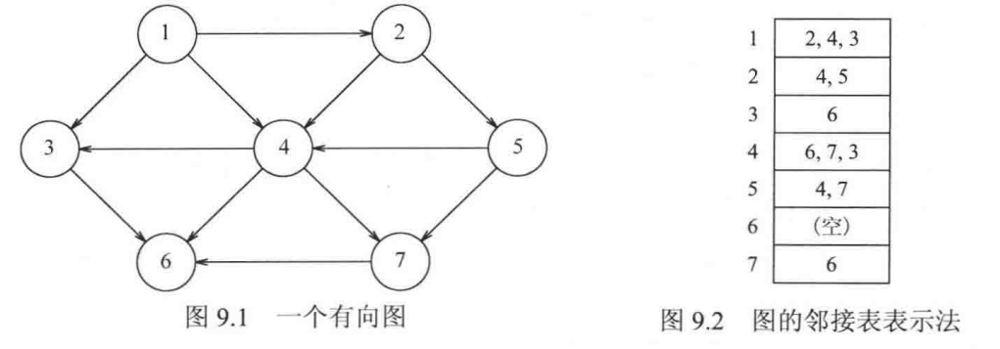
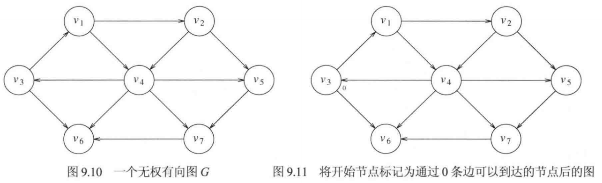
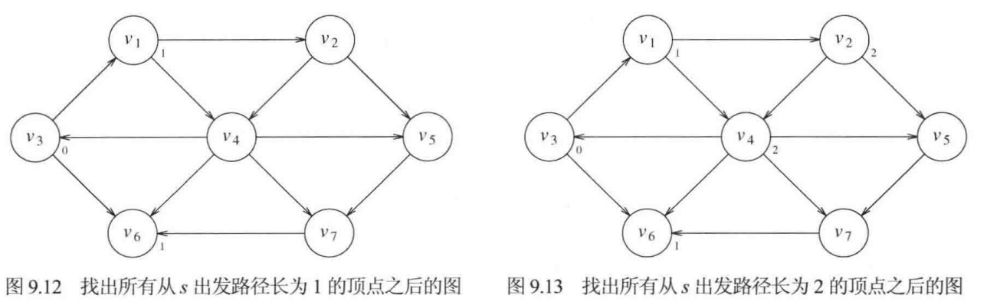
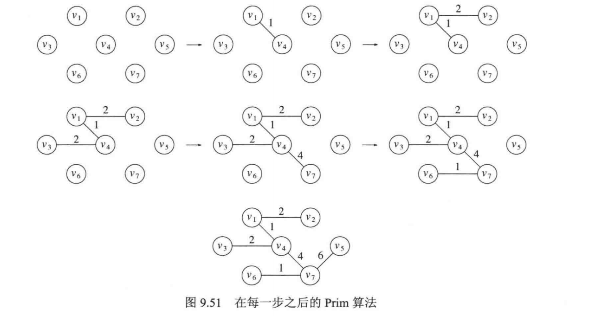
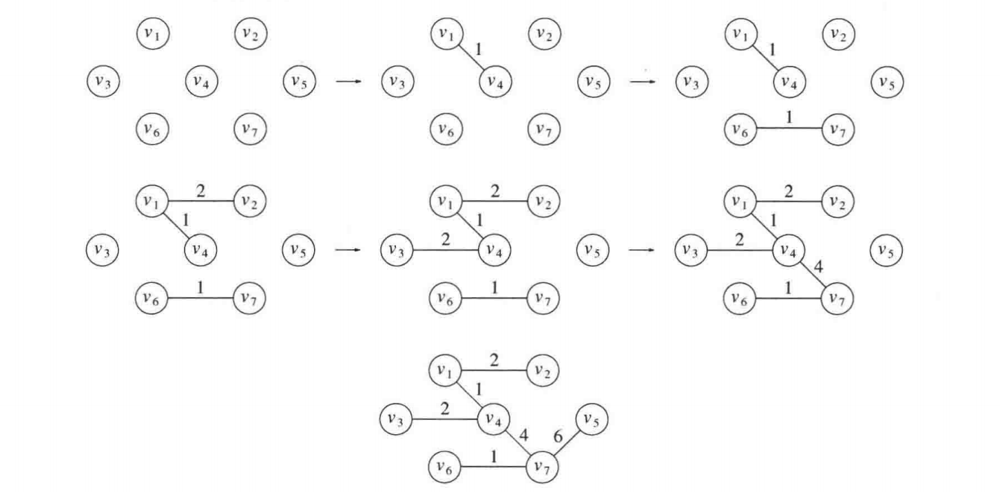

## 9.1 定义

一个**图**$`graph`$由**点**$`vertex`$集和**边**$`edge`$集组成：  

```math
G=(V,E)
```

每一条边是一个点对$`(v,w)`$，其中$`v,w\in V`$.  
若点对是有序的，则称图是**有向**的。  
$`w`$**邻接**到$`v`$当且仅当$`(v,w)\in E`$.  

**路径**：顶点序列$`w_1,w_2...w_i`$使得$`(w_i,w_{i+1})\in E`$.  
记边的数量为路径的长，只有一个点的路径的长为0.  
从一个顶点到它自身的边叫做**环**。  
满足$`w_1=w_N`$的边叫做圈。  
注意：在无向图中，$`u,v,u`$不是一个圈，因为$`(u,v)`$和$`(v,u)`$是一条边，但在有向图中它是一个圈。  
两两顶点之间存在路径的无向图是**连通的**，有向图是**强连通的**。  
一个有向图去掉箭头后的无向图即为**基础图**，若基础图是连通的，则该有向图是**弱连通的**。  
强联通的例子：  
A → B → C → A  
弱连通的例子：  
A → B → C  

**连通分量**是无向图中，一块“内部互相能到达、与外部不相连”的顶点集合。  
**图的表示**  
若图是稠密的即$`|E|=\Theta(|V|^2)`$，则适合用邻接矩阵表示，即二维bool数组。  
若图是稀疏的，则适合用邻接表法，空间复杂度为$`O(|E|+|V|)`$.  



## 9.2 拓扑排序

定义：满足一定元素先后顺序的排列，可能会有多种，因此必须是无圈图才有拓扑排序。  

## 9.3 最短路径算法  
**无权图**  





如图，考虑一个无权的有向图，记$`v_3`$为输入源$`s`$.  
从$`s`$出发，只需一步即可到达得有$`v_1`$和$`v_6`$.  
从$`v_1`$和$`v_6`$出发，可一步到达$`v_2`$和$`v_4`$.  
从$`v2`$和$`v4`$出发，可一步到达$`v_5`$和$`v_7`$.  
这种算法叫做**广度优先搜索**。  

**有权图**  
采用**Dijkstra算法**，每轮每个顶点都需要遍历，每条边都需要更新一次，故时间复杂度为  

```math
O(|E|)+O(|V|^2)=O(|V|^2)
```

当图是稠密的时，即$`|E|=\Theta(|V|^2)`$时，该算法为最优，与变数为线性关系。  
注意：这种算法只能处理权重非负的图。

## 9.5 最小生成树  
生成树：从一个连通无向图中选出一些边，保留全部顶点，使它们仍然连通，而且没有环。  
最小生成树：无向图中边权和最小的生成树，边数为$`|V|-1`$.  

**Prim算法**  
在每一阶段，选择边$`(u,v)`$，使得$`(u,v)`$的值是所有$`u`$在树上$`v`$不在树上的最小值，**注意：这条边不必是从最新连接的节点发出的。** 初始选择一个节点直接放进树中。  



**Kruskal算法**  
初始把所有顶点视作一棵树，所有顶点视作一个森林，按每条边的权值由小到大申请连接两棵树。对于每次申请，若边的两端已经在树中，则拒绝本次申请以免成环。  



## 9.6 深度优先搜索

从顶点$`v`$开始处理，递归遍历所有邻接$`v`$的节点。  
为了防止一个顶点被遍历多次，可以添加一个bool属性表示该点是否被遍历过，直到所有顶点都被标记过为止，总时间为$`O(|E|+|V|)`$.  
如果一次 DFS 没访问完所有顶点，说明图不连通。再从未访问的点开始，每次得到一棵树，合起来叫**深度优先生成森林**。

## 流网络

流网络是有向图，规定一个源点$`s`$和汇点$`t`$，流量会从源点流出，流入汇点，流量是守恒的。对于每条边 $`(u,v) \in E`$，都有一个非负的容量 $`C(u,v)`$，每条边的流量不能超过容量，每个节点的流入量等于流出量。  
对于一个环（这里不允许环的长度为1或2），环上的每条边的流量同时增大或减小相同的量（在容量以及总流量限制内），仍然满足流网络的性质。  
一个流网络中流量的定义：

```math
|f|=\sum_{v \in V}f(s,v)=f(s,V)
```

其中规定$`|f|`$可以为负，表示反向，$`V`$表示顶点集合，这种写法叫做隐式求和。  
一个重要但是很显然的定理：

```math
f(s,V)=f(V,t)
```

即从源点流出的流量等于汇入汇点的流量。  
证明如下：

```math
f(s,V)=f(V,V)-f(V-s,V)
```

其中$`f(V,V)=0`$，显然的，于是

```math
f(s,V)=f(V,V-s)=f(V,t)+f(V,V-s-t)
```

引理：对于非源点和汇点的点，都遵循流量守恒

```math
u \in V-\{s,t\}, \sum_{v \in V}f(u,v)=0
```

上式的$`f(V,V-s-t)=-f(V-s-t,V)=0`$，证毕。

割的定义：将顶点集合$`V`$分为两个集合$`S`$和$`T`$，满足$`s \in S,t \in T`$，其他顶点任意分配。  
则显然有

```math
c(S,T)=\sum_{u \in S}\sum_{v \in T}c(u,v)
```

```math
f(S,T)=\sum_{u \in S}\sum_{v \in T}f(u,v)
```

有一个强大的定理：对于任意的一个割

```math
|f|=f(S,T)
```

直观来看，源点在一边，汇点在另一边，那么穿过这个割的流量必然是总流量。  
证明如下：

```math
f(S,T)=f(S,V)-f(S,V-T)=f(S,V)-f(S,S)=f(S,V)
```

```math
f(S,V)=f(s,V)+f(S-s,V)
```

再次借助上述流量守恒的引理可知$`f(S-s,V)=0`$，证毕。

最大流问题：给定一幅图，包括各条边的容量，求总流量（源点流出的流量）最大值。  
残量网络：$`G_f`$也是一幅图，顶点和原图完全相同，每条边满足

```math
c_f(u,v)=c(u,v)-f(u,v)
```

其中对于每个不同的流量$`f`$都会有不同的图$`G_f`$.  
在残量网络中，原图每两个相邻顶点之间会有两条边，正向边（方向与原图相同）表示可添加的流量，反向边表示可减少的流量（因为有时我们需要通过减少某条边的流量来换取更大的总流量），即当前实际流量。如果可添加流量为0，则在残量网络中不需要画出这条正向边。  
增广路径：在残量网络中一条从源点通向汇点的路径，正反向边都可以走。在这条路径中，最小的残留量就是这条增广路径的值。
