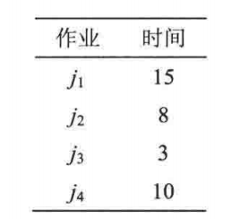
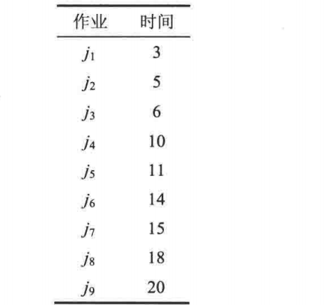
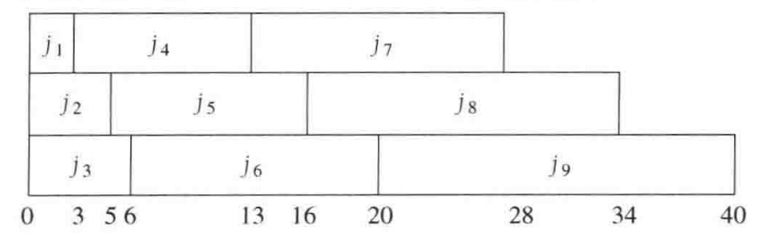
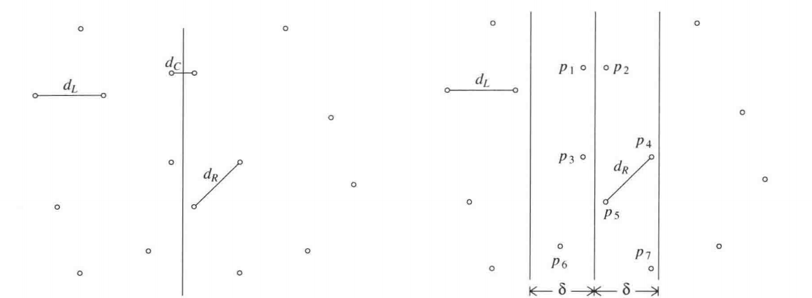
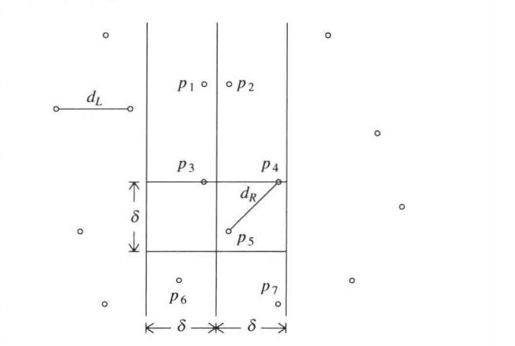

## 10.1 贪心算法

**单处理器问题**



要求平均完成时间的最小值，很显然，只需从时间最短的开始完成。  
从表达式来看，我们希望时间短的任务贡献值尽可能大。

**多处理器问题**





基于单处理器的想法，即让时间短的任务贡献多次，可以找到最优解。

## 10.2 分治算法

分：递归解决较小问题 ——> 治：从子问题的解构建原问题的解  
一些分治算法的运行时间满足

```math
T(N)=2T(N/2)+O(N)
```

这个方程的解是$`O(logN)`$.

**最近点对问题**

平面内有一些点，如何找到距离最近的点对？  
我们把平面的点对按横坐标均分为两半，其中设左半最短距离为$`d_L`$，右半最短距离为$`d_R`$，横跨左右的最短距离为$`d_C`$.  
现在我们希望求解$`d_C`$的时间为$`O(N)`$.  
记 $`\delta=min(d_L,d_R)`$，则若想找到 $`d_C<\delta`$，则必然要在中界线两端宽为$`2\delta`$的带状区域寻找，如图所示：



将中间带状区域的所有点按照纵坐标排序，依次枚举，我们仍然希望找到 $`d_C<\delta`$，故只需在纵坐标相差为$`\delta`$的区域内寻找（只需在大于或小于的一边即可），如图所示：



考察左右两个小正方形，由于他们中的点都分居两侧，故间距最小值为$`\delta`$。  
显然：在 $`\delta\times\delta`$ 的矩形区域内，两两间距大于等于$`\delta`$的点最多为4个，两个正方形区域就最多有8个，其中包括当前枚举的点和重合的点，实际上每轮需要枚举的点不足8个，即每轮时间为$`O(1)`$，总共需要枚举$`O(N)`$轮，因此寻找$`d_C`$的时间为$`O(N)`$.

## 10.3 动态规划

将递归中计算的答案记录在一个表内，如计算斐波那契数列时，将每一项记录，可以避免低阶项被计算次数的爆炸性增长。

**所有点对最短路径--Floyd算法**

前提：有向图，图中不能有负值环，否则不存在最短距离。  
记$`D_{k,i,j}`$表示从$`v_i`$到$`v_j`$只允许经过$`v_i,...v_k`$中一个或多个作为中间点时的最短路径。  
根据是否经过$`v_k`$分类讨论：  
若不经过$`v_k`$，则路径只用到$`v_1,...v_{k-1}`$作为中间点，最短距离为$`D_{k-1,i,j}`$  
若经过$`v_k`$，则路径可拆分为$`v_i \to v_k`$和$`v_k \to v_j`$两段，最短路径为$`D_{k-1,i,k}+D_{k-1,k,j}`$  
则有

```math
D_{k,i,j}=min(D_{k-1,i,j}\ ,\ D_{k-1,i,k}+D_{k-1,k,j})
```

这个算法的时间复杂度为$`O(|V|^3)`$，比Dijkstra复杂度更高。但它枚举了所有路径的情况，所以即使存在权为负值的图，这个算法也能跑通。而Dijkstra算法认为经过更多点路径长必然会变长，因此不能处理权为负值的图。

**关于为什么循环时k要放在最外层**

举个例子：  
假设顶点编号是 `0、1、2、3`，边只有：  
0 → 2，权重 1  
2 → 1，权重 1  
1 → 3，权重 1  
所以 `0 → 3` 的实际最短距离是 `3`。

**`k` 放最外层时：**

轮到 `k=1`（在1处中转），先算出 `2 → 3`：`2 → 1 → 3`，距离是 `2`。  
轮到 `k=2`（在2处中转），再算出 `0 → 3`：`0 → 2 → 3`，距离是 `1+2=3`。

每次加入一个中转点，都先把所有起点终点的距离更新完。

如果改成 `i、j、k` 的顺序，程序会先检查 `0 → 2 → 3`。但这时 `2 → 3` 还没算出来，`0 → 3` 就错过了这条路线。之后虽然算出了 `2 → 3`，程序也不会回头重算 `0 → 3`。

## 计算矩阵乘法最优排序

对于 $`p \times r`$ 和 $`r \times q`$ 的矩阵相乘，需要进行$`prq`$次乘法。  
左矩阵的每行（$`p`$行）每个元素（$`r`$个）跟右矩阵相应的行中每列（$`r`$列）的元素相乘。  
设$`m[i][j]`$表示$`A_iA_{i+1}...A_j`$所需最小乘法次数，要求$`i \leq j`$，且当$`i=j`$时有$`m[i][j]=0`$.  
当$`i \neq j`$时，

```math
A_iA_{i+1}...A_k|A_{k+1}...A_j
```

我们将其划分为两个子问题，左边最小次数为$`m[i][k]`$，右边最小次数为$`m[k+1][j]`$。设第$`i`$个矩阵的行数为$`p_i`$，列数为$`q_i`$，则最后一次乘法的次数为$`p_iq_kq_j`$，由于$`p_i=q_{i-1}`$，又可以写为$`q_{i-1}q_kq_j`$，那么整个矩阵乘法所需最小次数就是所有的划分中最少的那种，即

```math
m[i][j]=min(m[i][k]+m[k+1][j]+q_{i-1}q_kq_j)
```

## 10.4 随机化算法

首先，为什么需要随机化算法？  
以快速排序为例，如果每次都以第一个元素为枢轴，那么对于随机输入，平均时间为$`O(NlogN)`$，但对于特定输入，时间就会退化为$`O(N^2)`$，我们不能指望输入是完全随机的，但是我们可以让算法实现中存在随机。  
随机化算法生成随机数，根据随机数做决定，因此对于同一输入可能会有不同结果和不同时间。分析随机化算法时我们关注的就是犯错概率与时间期望。

**Monte Carlo 算法**

保证时间不保证结果，比如检查矩阵乘法：  
对于两个$`n \times n`$的矩阵相乘，利用简单的算法，由上述内容，时间复杂度为$`O(N^3)`$.  
而 Stassen 算法可以更快地解决这个问题，它可以用7步解决$`2 \times 2`$矩阵乘法。把一个 $`N\times N`$ 矩阵切成 4 个 $`N/2\times N/2`$ 的小矩阵。它用 **7 次**小矩阵乘法完成计算，再做 $`O(N^2)`$ 次加减法。因此时间满足：

```math
T(N)=7T(N/2)+O(N^2)
```

解得

```math
T(N)=O(N^{log_27})
```

可以发现，如果为了检查矩阵乘法是否计算正确，而去让计算机重新计算一遍的开销是很昂贵的，因此我们引入更高效的检查方法。

- Freivalds 算法

该算法的时间复杂度为$`O(N^2)`$.  
计算正确时，$`P(输出YES)=1`$  
计算错误时，$`P(输出YES) \leq \frac{1}{2}`$  
具体操作是，随机生成一个$`n \times 1`$的向量$`r`$，显然$`n \times n`$的矩阵与这个向量相乘的时间为$`O(N^2)`$，那只需判断

```math
ABr=Cr
```

如果成立就返回YES，否则返回NO。  
显然，当$`AB=C`$时，上式成立。  
当$`AB \neq C`$时，构造$`D=C-AB`$，那么$`D`$至少有一位不为零。  
假设有一个向量 $`r`$ ，使得

```math
Dr = 0
```

此时就会判断计算正确，即判断错误。（这种情况显然是存在的）  
假设$`D_{ij} \neq 0`$，构造一个向量$`v`$，其中$`v_{j} \neq 0`$，则$`(Dv)_i \neq 0`$，则有

```math
D(r+v) \neq 0
```

即只要存在一个能使算法误判的向量$`r`$，就有至少一个能使算法正确执行的向量$`r+v`$，因此误判的概率小于等于$`\frac{1}{2}`$.  
注意：$`v`$是根据$`D`$构造的固定向量

**Las Vegas 算法**

保证结果不保证时间，比如快速排序  
众所周知，如果固定枢轴的位置，那对于某一类输入就会造成$`O(N^2)`$的最坏情况，随机选择枢轴可以降低连续极端划分的概率，但最坏情况仍为$`O(N^2)`$.

- Paranoid quicksort

随机选择枢轴，若划分不在1:3或者3:1内就重新选择枢轴。  
显然，选择到合适的枢轴的概率为$`\frac{1}{2}`$，根据几何分布，选择到合适枢轴的尝试次数为2。  
如此，把每次划分的两端想象为一棵树，则较深的一侧至多为$`\frac{3}{4}`$，因此树的深度仍然是$`O(logN)`$.

## 跳表

对于动态集合，我们希望常见的操作都在$`O(logN)`$时间完成。  
对于一般的双向链表，访问和查找的平均时间为$`O(N)`$，如果采用双向链表，比如

```text
L1:  14------34--42--------------72
      |       |   |               |
L0:  14--23--34--42--50--59--66--72--79
```

这样，如果我们预先知道需要走很远，就无需一直走普通线，可以直接走快车线。  
假设上层节点均匀分布，访问的最坏情况所需时间为

```math
|L_1|+\frac{|L_0|}{|L_1|}
```

第一项即$`|L_1|`$从头走到尾，第二项就是切换到$`|L_0|`$后剩余步数。  
显然，当$`|L_1|=\sqrt{|L_0|}`$时上式取最小值，即时间复杂度为$`O(2\sqrt{N})`$.  
当然，我们的目标是达到$`O(logN)`$，考虑继续加链，有三条链时，时间为

```math
|L_2|+\frac{|L_1|}{|L_2|}+\frac{|L_0|}{|L_1|}
```

显然，最小时间为$`O(3\sqrt[3]{N})`$.  
则对于 $`k`$ 条链，最小时间为$`O(k\sqrt[k]{N})`$.  
取 $`k=log_2N`$，则有时间复杂度为$`O(2log_2N)`$.  
例如：

```text
L3:  14------------------------------79
      |                               |
L2:  14--------------50--------------79
      |               |               |
L1:  14------34------50------66------79
      |       |       |       |       |
L0:  14--23--34--42--50--59--66--72--79
```

这就是一个很理想分布的跳表，每层的元素数大约是下一层的一半。考虑插入67这个元素，如果直接就插入$`L_0`$，那么在反复插入删除后跳表的理想的分布就会被破坏，因此考虑随机插入。具体操作是，通过抛硬币来决定是否上升，正面朝上就上升，否则下降，根据概率分布可以大致维持理想分布。  
在查找中，只要目标值小于下一个元素就下降。这里就会遇到一个问题，即插入了很小的元素会影响，因此一般在每条链的表头和表尾放负正无穷。  
对于插入操作：  
插入$`n`$个节点，至少存在一个节点插入超出最大高度$`k`$的概率为

```math
P=\frac{n}{2^k}
```

再令$`k=clog_2n`$，  
可得插入高度在最大高度范围内的概率为

```math
P=1-\frac{1}{n^{c-1}}
```

**结论：在高概率下插入时间为$`O(logN)`$**

对于查找操作，这里做逆向研究：  
节点被提升意味着从上一条链下来的  
反向找到负无穷时停下，这就是出发点  
以查找66为例：  
逆向查找的过程：  
$`66(L_0)\to66(L_1)\to50(L_1)\to50(L_2)\to14(L_2)\to14(L_3)`$  
某节点上升说明在抛硬币决策时是正面朝上，因此研究链表的高度可以看做计算，在总的硬币序列中（构造链表时产生的序列），涉及查找路径的一个子序列中正面向上的次数，则对于查找路径上的某个节点，上升或者左移的概率均为$`\frac{1}{2}`$（实际上查找序列是固定的，我们研究的是构造这个序列的概率）。  
向上的步数 $`<`$ 层数 $`\leq clogN`$ （w.h.p）  
而在高概率下，层数是$`O(logN)`$，此时最高层的节点数是常数级别的，所以可以近似认为达到起点的步数 = 上升到最高层的步数 = O(上升clogN次)=O(硬币clogN次正面朝上)  
所以后面就需要证明，“硬币clogN次正面朝上所需步数为对数级别”是高概率事件。

引理：Chernoff Bound  
m次独立抛硬币中，正面数偏离期望的程度每增加一点，它的概率都会指数级地变小。

```math
P(Y>E[Y]+r)≤e^{-2r^2/m}
```

其中$`Y`$表示反面朝上的次数，$`m`$表示样本量，$`r`$表示偏离数。  
取

```math
m=8clogN
```

则

```math
E(Y)=4clogN
```

而

```math
Y=m-clogN=7clogN
```

因此

```math
r=Y-E(Y)=3clogN
```

最后不符合预期的概率

```math
P=n^{-2.25c}
```

显然很小。  
最后，还需证明A事件（层数$`\leq clogN`$）和B事件（硬币clogN次正面朝上所需步数为对数级别）一起发生是高概率事件。  
由上述连等式可知：A实际上是B的前提，因此

```math
P(A∧B)=P(A)⋅P(B∣A) ≥ (1−\frac{1}{n^a})(1−\frac{1}{n^b}) ​
```

## 全域哈希与完美散列

目标：实现时间复杂度$`O(1)`$，空间复杂度$`O(N)`$.  
设$`u`$为所有可能key值的总数，$`n`$为当前哈希表的装载量，$`m`$为哈希表的容纳量。  
则对于普通的哈希表，key值随机的情况下近似有

```math
P(k_1 \neq k_2,h(k_1)=h(k_2))=\frac{1}{m}
```

**全域哈希**

适用于动态数据（反复插入删除的一组数据），且对输入没有要求，插入删除查找都以$`O(1)`$时间完成。  
对于函数簇$`H`$，对于任意的key值都有

```math
P(k_1 \neq k_2,h(k_1)=h(k_2)) \leq \frac{1}{m}
```

但这与普通哈希是不同的，这里$`k_1`$和$`k_2`$都是固定的，而函数$`h(x)`$是随机选择的。  
下面求解每条链的期望长度：  
设

```math
I_{ij}=
\begin{cases}
1, & h(k_i)=h(k_j) \\
0, & h(k_i) \neq h(k_j)
\end{cases}
```

对于任意的$`k_i`$，key值冲突次数的期望为

```math
E((\sum_{j \neq i}I_{i,j})+I_{i,i})=\sum_{j \neq i}(E(I_{i,j}))+1 \leq \sum_{j \neq i}\frac{1}{m} + 1 \leq \frac{n}{m} + 1
```

下面来看几个全域哈希的实例：

- 随机映射

```math
H=\{h:(0,...u-1) \to (0,...,m-1)\}
```

很显然，这个散列函数的冲突概率为$`\frac{1}{m}`$，但这是一个很差的函数簇，为了保证每个key值都有唯一槽位，需要记录下来每次随机的结果，需要时间和空间均为$`\Theta(u)`$.

- 点积哈希

设素数$`m`$，取$`r=\lceil log_mu \rceil`$，设$`k`$为需要散列的key值，写作$`m`$进制向量

```math
k=<k_0,...k_{r-1}>
```

设$`a`$为随机参数向量

```math
a=<a_0,...,a_{r-1}>
```

```math
h_a(k)=ak\mod m
```

点乘的结果

```math
h_a(k)=\sum_{i=0}^{r-1}a_ik_i\mod m
```

那么全域函数簇

```math
H=\{h_a|a \in \{0,1,...u-1\}\}
```

对于一个哈希表实例，只需抽取一个$`a`$，因此时间和空间均为常数。  
下面证明点积哈希的全域性：  
设两个key值$`k`$和$`k'`$，冲突等价于

```math
\sum_i a_i(k_i-k'_i) \equiv 0\mod m
```

$`k`$和$`k'`$至少有一位不同，记为$`d`$，设$`\Delta_d=k_d-k'_d`$，拆分出d项

```math
a_d\Delta_d \equiv c \mod m
```

其中$`c=-\sum_{i \neq d}a_i\Delta_d`$  
由于m是素数，因此存在唯一的$`a_d \in \{0,1,...,m-1\}`$使得上式成立，这可以理解为m进制，又因为a是随机的，$`a_i`$是相互独立的，所以$`a_d`$是均匀分布的，即冲突概率为$`\frac{1}{m}`$

## 完美哈希

仅供查找，查找时间复杂度$`O(1)`$，空间复杂度$`O(n)`$.

- 第一阶段：构建主表

随机选择一个散列函数，记$`l_j`$为第$`j`$个位置key值的数量，则有$`m=\Theta(n)`$  
若

```math
\sum l_j^2 > cn
```

则重新随机选取一个散列函数。  
失败的概率小于$`\frac{1}{2}`$，因此平均尝试次数为2。  
若考虑高概率下，则跟跳表中类似，成功插入的时间为$`O(logn)`$.  
每次尝试的代价为$`O(n)`$，因此总时间为$`O(nlogn)(w.h.p)`$

- 第二阶段：构建二级散列表

然后给每个位置的key值重新散列到各自一个新的哈希表里面，大小为$`l_j^2`$，散列函数也随机重新选取，若发生冲突，则再重新选取散列函数。  
对于一个大小为$`n^2`$的哈希表，若存入$`n`$个key值，则发生冲突的概率

```math
P=\sum_{i \neq j}p=C_{l_i}^2p \leq C_{l_i}^2\frac{1}{l_i^2} = \frac{1}{2}(1-\frac{1}{l_i})\leq\frac{1}{2}
```

同理，平均尝试次数为2。  
若考虑高概率下，平均每个元素成功插入的时间为$`O(logn)`$.  
而$`l_i=O(logn)`$（证明略，实际上更小），因此总时间为$`O(nlog^2n)(w.h.p)`$，接近线性。

综上，整个构建时间平均为$`O(n)`$，高概率下接近线性。

最后研究空间复杂度：

```math
E(\sum_{j=1}^{m-1}l_j^2)=E(\sum_{i = 1}^{n}\sum_{j = 1}^{n}I_{i,j}) =\sum_{i = 1}^{n}\sum_{j = 1}^{n}E(I_{i,j})\leq n+2C_{n}^2\frac{1}{m}=\Theta(n)
```

$`l_j^2`$ 就是总共 $`l_j`$ 个元素在第一级表中的碰撞次数，可以看做算是两个输入，注意正反碰撞算两次，也包括自配对（如果不包括自配对，那对于没有碰撞的情况，则$`\sum l_j=0`$，显然不符）。处理碰撞次数就可以引入上述$`I`$这个变量，将其转化为处理概率。（这里感觉很绕，我也没太搞明白）
