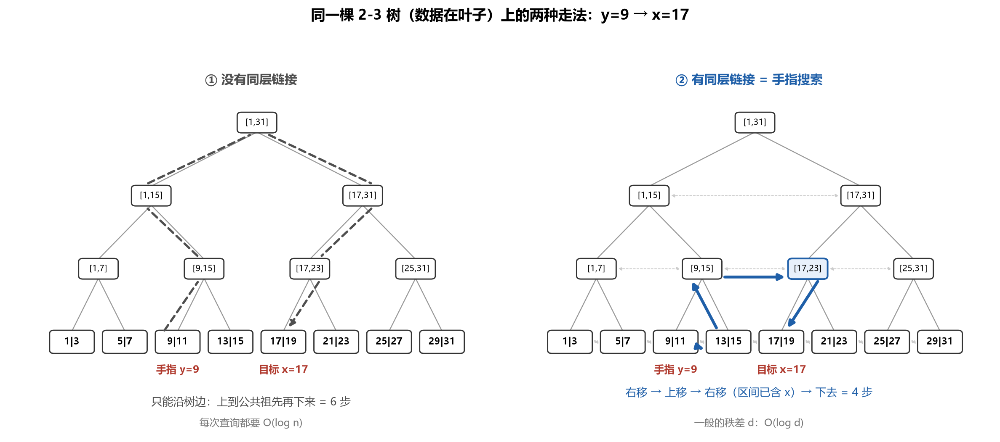
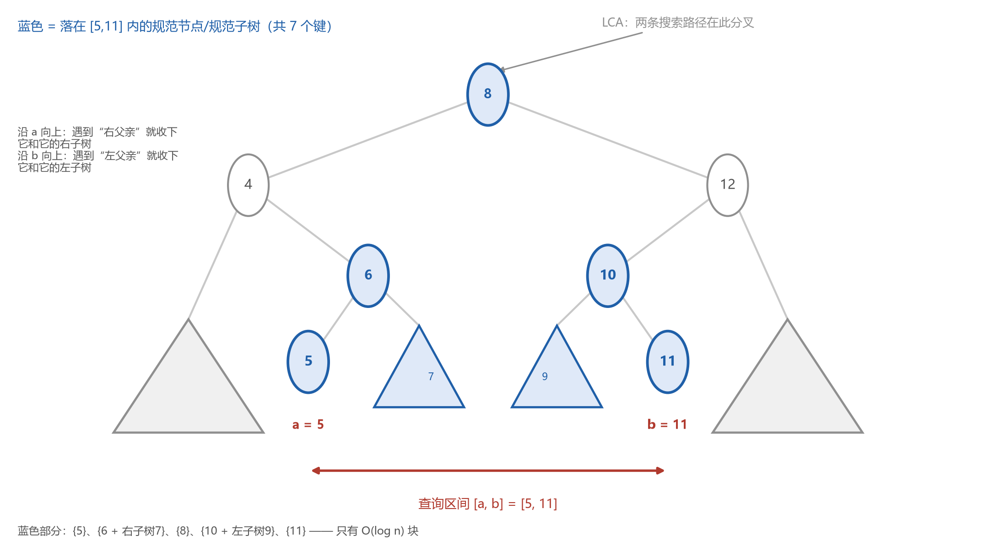

## 增广数据结构

增广的思想：比如在平衡二叉树每个节点多存一个参数，比如子树大小，用少量空间换取更强大的查询能力。

以AVL树为例，对于只由本身及其左右子树决定，且能在常数时间内合成的函数$`f`$具有良好的性质：操作一般在单一路径上，所以访问的节点数为$`O(logN)`$。一次旋转操作一般只涉及两个节点，只需常数时间维持新增的这个变量（比如子树大小）。

实例：  
实现rank函数  
AVL树满足左孩子小于自己，右孩子大于自己，定义函数size表示子树大小，则$`rank(x)`$就可从$`x`$出发向根走，逐步累积 $`x.left.size`$，若从1号开始累积，则最后再加1.  
时间复杂度为$`O(logN)`$.  
实现select函数  
如果每次都计算当前节点的rank值，那最坏时间会到$`O(log^2N)`$.  
考虑以$`x`$为根的子树，那么

```math
rank(x)=x.left.size
```

注意这是局部的排序，下面要比较的i也必须是局部排序。

```cpp
if ( i == rank(x) )
	return x;
else if ( i < rank(x) )
	x = x.left;
	// 往左走每个节点的 rank 都不会变，故不需更新 i
else
{
	x = x.right;
	i -= rank(x);
	// 往右走每个节点的 rank 都会变小，这时必须更新 i
}
```

从根节点开始遍历，时间为$`O(logN)`$.

## 层级链接——以2-3树为例：

我们希望在同一层的节点之间建立链接。  
每次分裂时，原本左侧链接指针指向左节点，原本右侧链接指针指向右节点，左右节点之间添加链接指针，融合节点类似，均为常数开销。  
手指搜索：  
记 $`d`$ 为两个节点的秩差，即两个节点之间有 $`d`$ 个元素，所以最坏只要 $`O(logd)`$ 步就能爬到“规模 $`≥d`$ 且把目标包含进来”的那个祖先，同理最坏下降深度也为 $`O(log⁡d)`$。如果没有层间连接，最坏时间为 $`O(logN)`$.  
从 $`y`$ 出发寻找 $`x`$：  
设 $`v`$ 为包含 $`x`$ 的节点，  
若

```math
v.min \leq x \leq v.max
```

则只需在 $`v`$ 的子树中进行常规的向下搜查。  
若

```math
x \leq v.min
```

则访问 $`v`$ 的同层左节点。  
若

```math
x \geq v.max
```

则访问 $`v`$ 的同层右节点。  
访问同层节点后需要向上访问父节点。  
横向指针负责“往正确的方向走一点”，向上负责“把视野放大”。



## 范围树

考虑一维空间，我们希望找出某个区间内所有点，这个搜索的前提是树结构已经建立好了，如图所示：  
取a的父节点，若父节点在a的右侧，则包含右子树，因为右子树的节点都大于a，然后一直向上走。同理，取b的父节点，若父节点在b的左侧，则包含左子树。最终找到两条搜索路径的交汇处，即LCA(Lowest Common Ancestor)。找点的个数的时间复杂度为$`O(logN)`$，注意这取决于树的高度而不是节点数目。设点的个数为$`k`$，则把这些点都找出来还需要$`O(k)`$.



在二维空间中，想要找到某个矩形中点的个数。  
预处理：建立了$`n+1`$棵树，建树过程就是先按照x方向建立一棵树（主树），然后取每一棵子树上所有节点，再根据y建立一棵新的子树。

*注意：直接对两个方向搜索没用，比如年龄 30–40 的有 100 人、工资 1–2 万的有 50 人，推不出"同时满足的有多少人"*

第一步，先对$`x`$方向上进行搜索，结果有两类：  
$`O(logN)`$的单个节点，比如上图的5,6等  
$`O(logN)`$的子树，比如上图的7,9等  
对于单条路径除了起点外的每一层，都至多产生一个结果（单个节点或子树），因此两种结果的数量均为$`O(logN)`$.  
第二步，分别处理第一步产生的两类结果：  
对于单个节点，直接判断即可，时间复杂度为$`O(1)`$，总时间为$`O(logN)`$.  
对于子树，就按照相同方法搜索，每颗子树搜索时间为$`O(logN)`$，则总时间为$`O(log^2N)`$.  
如果还需要考察具体的点，则再加$`O(k)`$.
